# Disney's Extreme Skate Adventure, in Rust

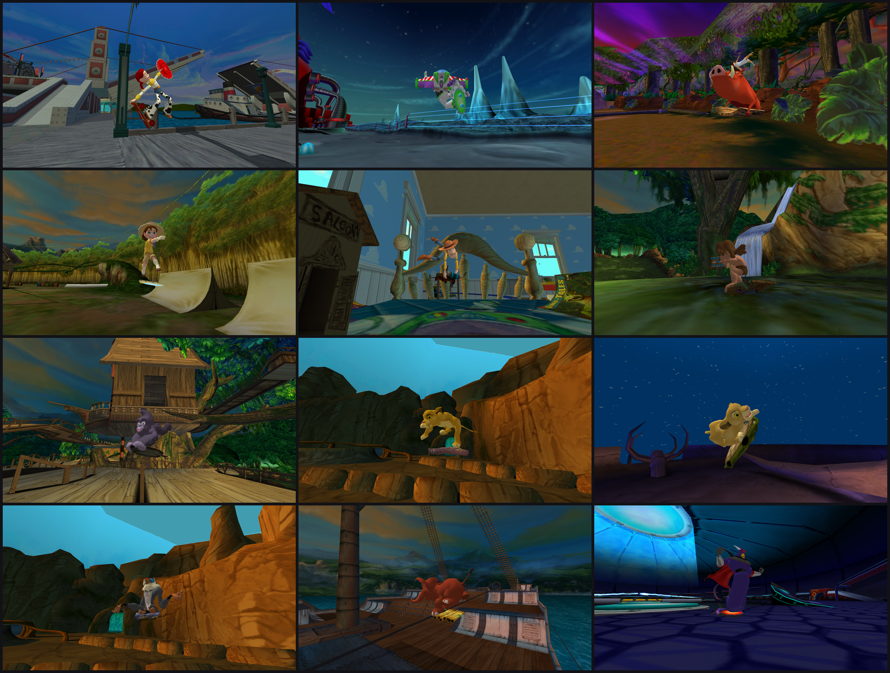

A from-scratch Rust reimplementation of *Disney's Extreme Skate Adventure*
(Toys for Bob, 2003), built by studying the GameCube release, with the
game's own physics, tricks, goals and menus, plus optional modern graphics.

> **No game data is included.** You need your own copy of the game (a plain
> `.iso` / `.gcm` of the US GameCube release, `GEXE52`). This project isn't
> affiliated with or endorsed by Disney, Toys for Bob, Neversoft or
> Activision.

## Download

Get the Windows builds from the
[Releases page](https://github.com/FrosttysBots/Disney-Extreme-Skaters-Recomp/releases).
The easy way is **DESA-Launcher.exe**:

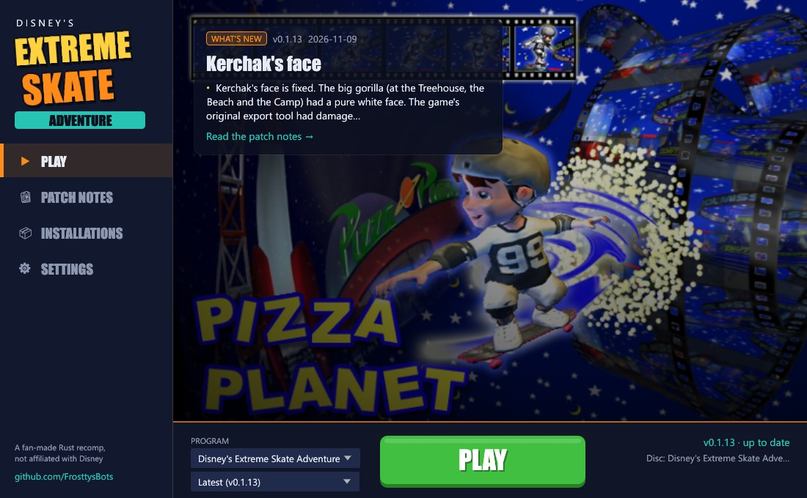

- **Setup on first run**: it installs itself (to `%LOCALAPPDATA%\Programs\DESA Recomp`), makes Desktop and Start menu shortcuts, asks for your disc image and downloads the latest release.
- **Updates from GitHub**: each time it opens it checks the releases, and the big button turns to **UPDATE** when there's a newer one. It updates itself too.
- **Play** the game or the Map Viewer, the latest or any older version; **Patch Notes** and **Installations** pages; **Uninstall** in Settings.
- The background is your disc's own loading screens. Put a `logo.png` next to the launcher to show your own logo instead of the drawn title.

<br clear="right">

Or download the programs themselves:

- **Disney-Extreme-Skate-Adventure.exe**: the game (opening movies, then the main menu).
- **DESA-Map-Viewer.exe**: the same game with a panel for flying round levels, characters, animations and debugging.

Put either next to your disc image, or pick it with **Open disc image...**
the first time. Convert `.rvz` and other formats to ISO in Dolphin first
(right-click the game, **Convert File...**). Settings are kept in
`%APPDATA%\desa-map-viewer\settings.txt`.

## Gallery

Every shot uses the optional **Advanced** graphics (sky, clouds, time of day,
weather and water). Left off, the game looks as it did on the GameCube.

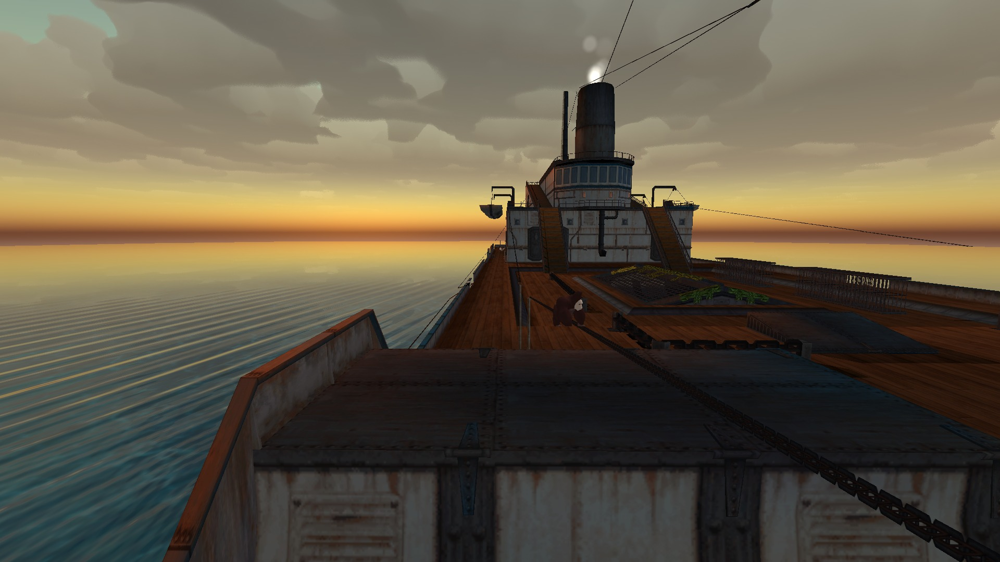

<table>
<tr><td width="33%">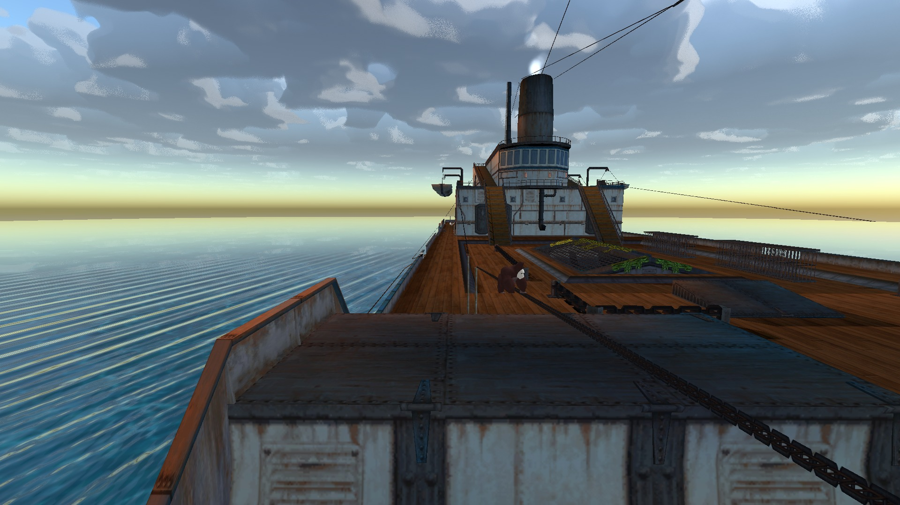</td><td width="33%">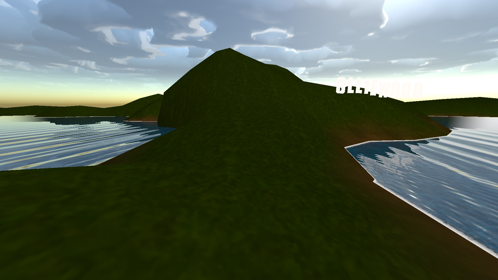</td><td width="33%">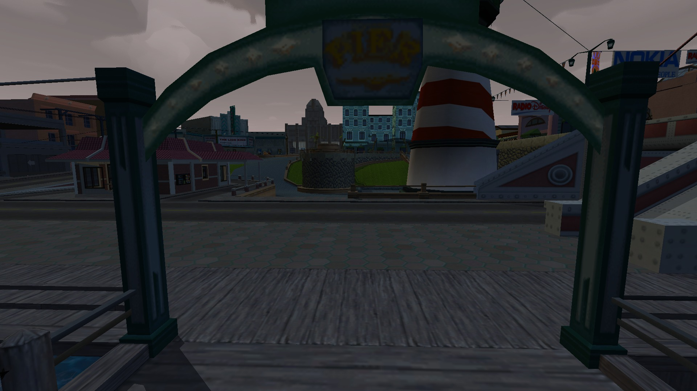</td></tr>
<tr><td width="33%">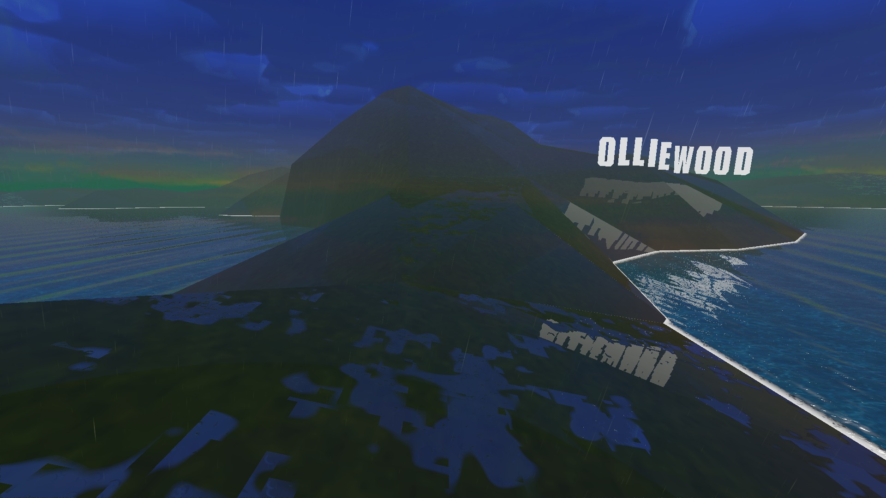</td><td width="33%">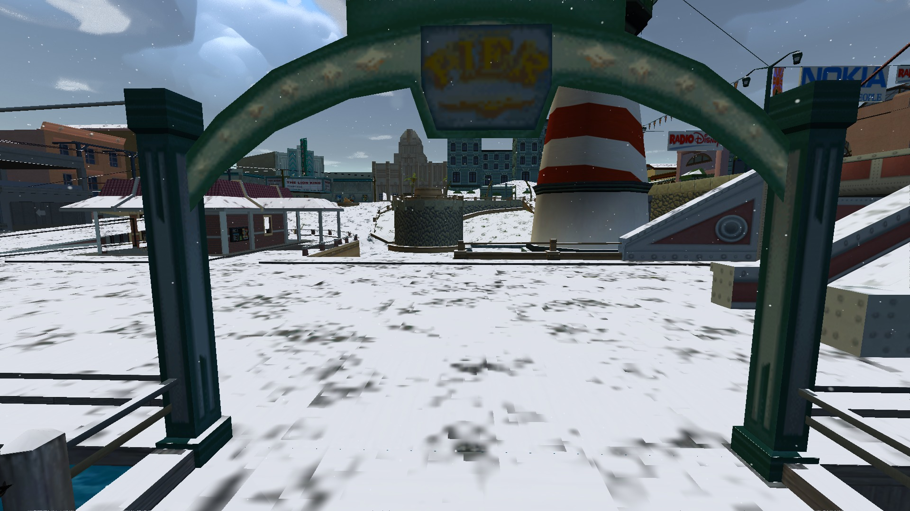</td><td width="33%">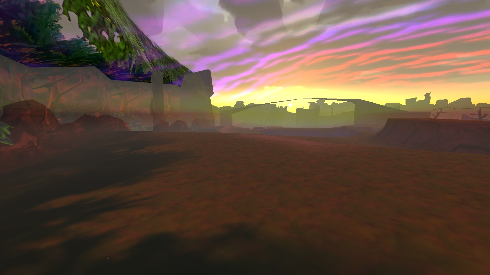</td></tr>
<tr><td width="33%">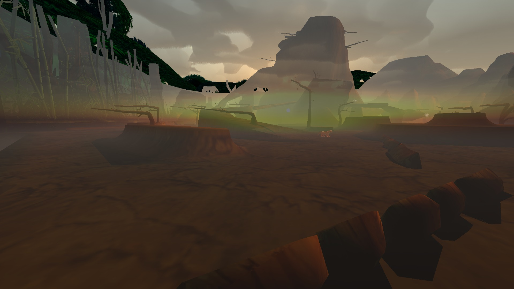</td><td width="33%">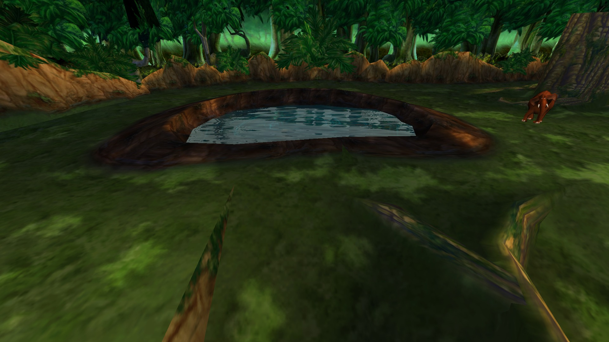</td><td width="33%">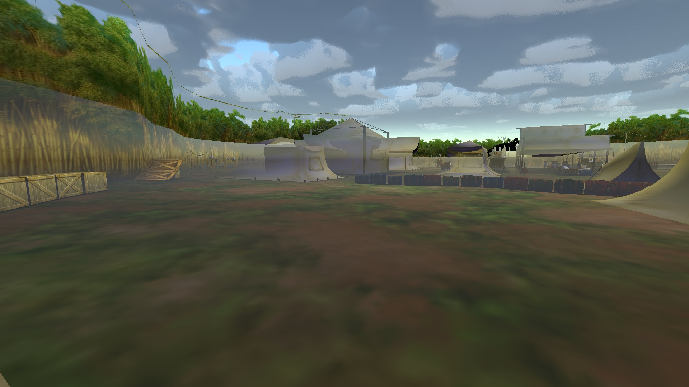</td></tr>
<tr><td width="33%">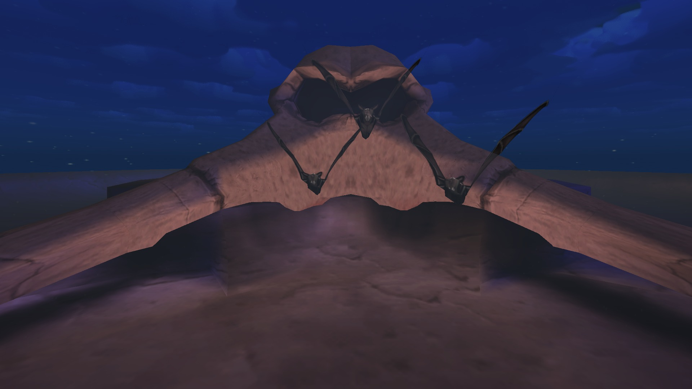</td><td width="33%">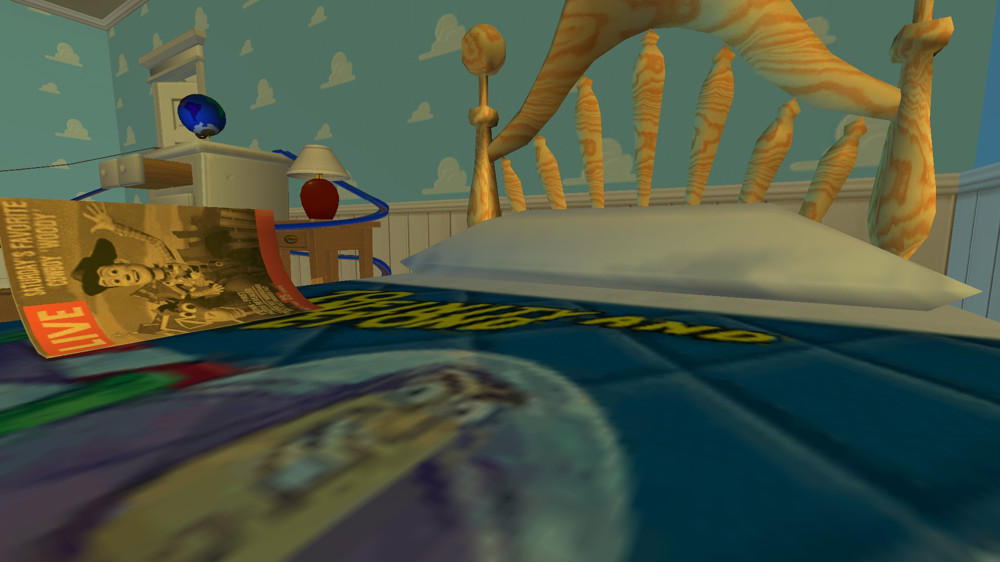</td><td width="33%">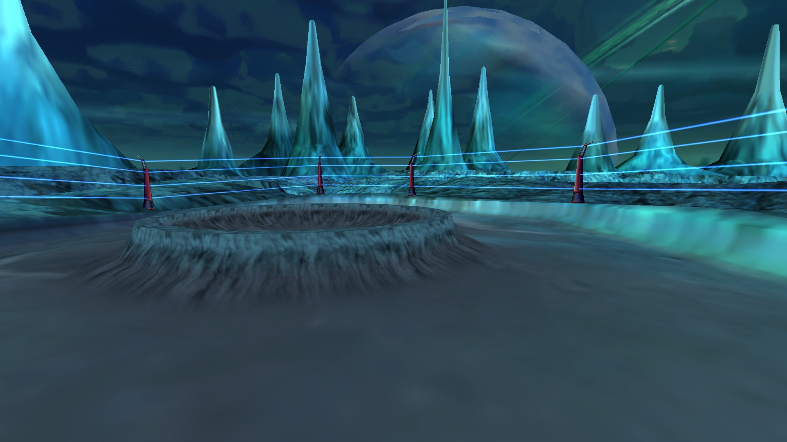</td></tr>
</table>

## What works

| Area | Status |
|---|---|
| Levels and characters | All 11 levels and 12 characters, with objects, pedestrians, vehicles on their paths, particles and the game's blend modes |
| Skating | The game's own physics from `main.dol`: ollies, grinds, manuals, lips, reverts, vert air and spine transfers |
| Tricks and scoring | Every character's flips, grabs, grinds, manuals and specials, combo scoring and the special meter ([alpha](docs/alpha-testing.md)) |
| Gameplay | Goals from the levels' scripts (score, S-K-A-T-E, races, collecting, gaps, trick spots, Skatetris), 2-minute runs, collectibles, warps, cheats and records. Two-player modes are built but greyed out for now |
| Menus and audio | The game's own screens run from its scripts (main menu, skater and level select, Create-A-Skater, pause, options); sound effects, music, voices and movies |
| PC extras | Video Options: display mode, size, VSync, frame limit, aspect ratio (4:3 to 32:9), bars, and **Advanced** graphics |
| Input | Gamepad with rumble, laid out like the GameCube pad, or keyboard |

### Advanced graphics

Options → Video Options → **Advanced**, ported from
[bevy_atmos](https://github.com/Nilbong/bevy_atmos) (MIT or Apache-2.0).
All of it is off by default, and **Reset Look** puts the disc's look back.

- **Atmosphere:**
  - **Sky:** the level's own, or a physical sky.
  - **Clouds:** volumetric clouds over either sky.
  - **Time of Day** and **Day Cycle:** the sun, moon and stars move, and the level's light follows them.
  - **Rain** and **Snow:** the ground gets wet and puddles reflect the level, snow settles, and neither falls under a roof.
  - **Water:** waves, reflections, sun glitter, see-through shallows and shoreline foam.
  - **Fog:** distant things fade into the sky.
- **Colour:** Exposure, Warmth, Tint, Contrast and Saturation.

Anti-aliasing, texture filtering, render scale, FOV and draw distance are
greyed-out placeholders for now.

## Controls

| Keyboard | Gamepad | Action |
|---|---|---|
| W / S, A / D | Left stick | Push, brake, steer (lean in the air) |
| Space (hold, release) | A | Crouch, ollie |
| Q / F (+ direction) | X / B | Flip / grab |
| E | Y | Grind, or a lip trick on the coping |
| W then S | | Manual (W / S balance; A / D balance grinds) |
| R | L / R | Revert |
| J / L | Right stick | Look round |
| P / Esc | Start | Pause |

The Map Viewer's fly camera, panel, debug keys and screenshot options are in
[docs/map-viewer.md](docs/map-viewer.md).

## Building

Install [Rust](https://rustup.rs) 1.85 or newer, then:

```
cargo build --release -p desa_viewer -p desa_launcher
```

This builds `target/release/desa-game.exe`, `desa-map-viewer.exe` and
`desa-launcher.exe`. Developed on Windows; the game should work elsewhere
(wgpu and winit) but hasn't been tried, and the launcher's downloads are
Windows-only.

## Documentation

- [Map Viewer, game and tools](docs/map-viewer.md): every control and mode, command-line screenshots, the `desa` tool and the crates.
- [Formats, physics and reverse engineering](docs/formats.md): how each file format was decoded and repaired, the physics port, the roadmap, and the Ghidra setup.
- [Physics notes](docs/physics-notes.md): every `main.dol` function read, with addresses.
- [Alpha testing](docs/alpha-testing.md): what to try, and what's known to be missing.
